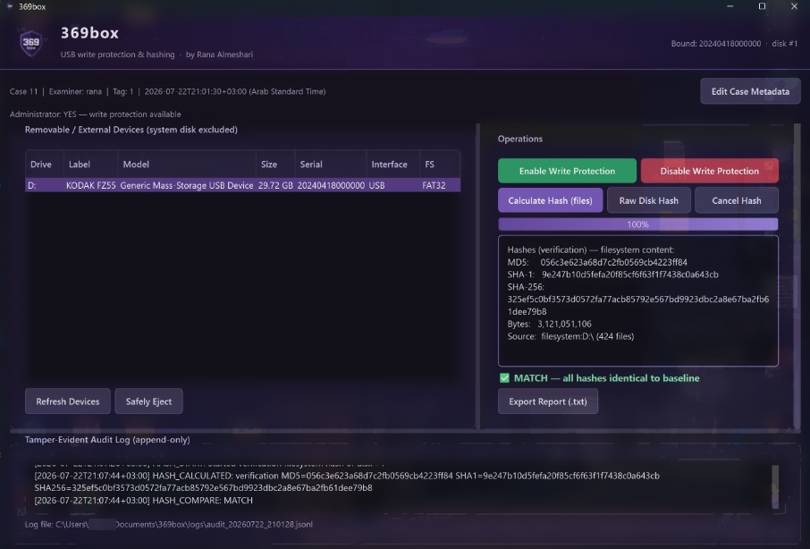

# 369Box

Windows tool for forensic drive acquisition: write-protects USB and external drives, verifies the protection with a test write, generates MD5/SHA-1/SHA-256 hashes, and keeps an append-only audit log of case details to support chain of custody.



## Why it exists

In digital forensics, evidence must not be altered during acquisition, and every action must be traceable. 369Box combines the core steps of a USB acquisition workflow (write protection, verification, hashing, and documentation) into one simple desktop app.

## Features

- **Drive discovery:** lists removable and external drives
- **Write protection:** turns disk read-only on or off, shows the protection status in the UI, and runs a test write after enabling to confirm writes are actually blocked
- **Hashing:** MD5 / SHA-1 / SHA-256, either per file or as a full raw disk hash
- **Case documentation:** basic case fields plus an append-only session log you can export
- **Safe eject:** safely ejects the selected drive when you're done

## Requirements

- Windows 10/11
- Python 3.10+
- Administrator rights for write protection (it uses Windows disk/volume APIs that need elevation)

## Setup

From the project root:

```
python -m venv .venv
.\.venv\Scripts\Activate.ps1
pip install -r requirements.txt
```

## Run

From the project root:

```
python main.py
```

Or double-click `run.bat` (right-click → **Run as administrator** for write protection).

**Tips:** close File Explorer windows for the drive before enabling protection. Hashing a full drive can take a long time.

## Known limitations

- Software write blockers can fail or be bypassed; a hardware write blocker remains the standard for court-grade acquisition
- Windows may already have touched the drive before protection is enabled
- Explorer or other apps keeping the drive open can make protection unreliable
- Raw disk hashing is slow on large drives; file hashing covers file contents only, not every byte on the disk

## Project structure

```
369box/
  main.py
  run.bat
  box369/
    devices.py        # drive discovery
    writeprotect.py   # read-only toggle and verification
    hashing.py        # MD5 / SHA-1 / SHA-256
    eject.py          # safe removal
    audit.py          # append-only session log
    case_meta.py      # case fields
    gui/              # PyQt6 UI (main_window, dialogs, styles)
    assets/
  screenshots/
```

## Tech stack

Python · PyQt6 · Windows disk/volume APIs

## Author

Rana Almeshari · [LinkedIn](https://linkedin.com/in/rana-almeshari)

## License

All rights reserved.
